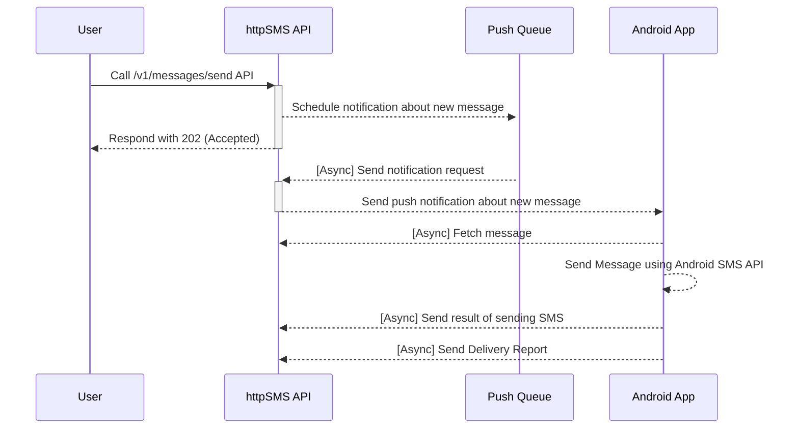

# httpSMS

[](https://github.com/Ciudad-Valles-Open-Source/httpsms/graphs/contributors)
[](https://github.com/Ciudad-Valles-Open-Source/httpsms/blob/main/LICENSE)
[](CODE_OF_CONDUCT.md)
[](https://discord.gg/kGk8HVqeEZ)

*🌎 [Leer en Español](README_ES.md)*

httpSMS is a free, open-source, self-hosted service that lets you use your Android phone as an SMS Gateway to send and receive SMS messages. This repository is a 100% free fork of [NdoleStudio/httpsms](https://github.com/NdoleStudio/httpsms): no paid plans, no limits, and no dependency on the hosted service.
You make a request to a simple HTTP API and it triggers your Android phone to send an SMS. SMS messages received on your android phone can also be forwarded to your webhook endpoint.

Quick Start Guide: open the **/docs** section of your web dashboard (e.g. `https://your-domain/docs`). The content lives in [`web/docs-content/`](./web/docs-content), and the API reference (Swagger) is served by the API at `/index.html`.


## Table Of Contents

<!-- START doctoc generated TOC please keep comment here to allow auto update -->
<!-- DON'T EDIT THIS SECTION, INSTEAD RE-RUN doctoc TO UPDATE -->

- [Why?](#why)
- [Web UI](#web-ui)
- [API](#api)
- [Android App](#android-app)
- [Chat/forum](#chatforum)
- [Features](#features)
  - [End-to-end Encryption](#end-to-end-encryption)
  - [Webhook](#webhook)
  - [Back Pressure](#back-pressure)
  - [Message Expiration](#message-expiration)
- [API Clients](#api-clients)
- [Flows](#flows)
  - [Sending an SMS Message](#sending-an-sms-message)
- [Self Host Setup - Docker](#self-host-setup---docker)
- [Integration Testing](#integration-testing)
- [License](#license)

<!-- END doctoc generated TOC please keep comment here to allow auto update -->

## Why?

I'm originally from Cameroon and I wanted an automated way to send and receive SMS messages using an API.
Unfortunately many countries don't support the ability to buy virtual phone numbers, and I could not find a good ready-made
solution that could help me send/receive SMS messages using a mobile phone using an intuitive http API.

## Web UI

The web interface (served at your `APP_URL`) is built using [Nuxt](https://nuxtjs.org/) and [Vuetify](https://vuetifyjs.com/en/).
It is hosted as a single page application on firebase. The source code is in the [web](./web) directory

## API

The API (served at your `API_BASE_URL`) is built using [Fiber](https://gofiber.io/), Go and [CockroachDB](https://www.cockroachlabs.com/) for the database.
It runs in Docker next to the web app. The interactive API reference (Swagger) is served by the API itself at `/index.html` (Spanish: `/es/index.html`).

```go
// Sending an SMS Message using Go
client := httpsms.New(
    httpsms.WithAPIKey(/* API key from the Settings page of your dashboard */),
    httpsms.WithBaseURL("https://api.your-domain.com"),
)

client.Messages.Send(context.Background(), &httpsms.MessageSendParams{
    Content: "This is a sample text message",
    From:    "+18005550199",
    To:      "+18005550100",
})
```

## Android App

[The Android App](https://github.com/Ciudad-Valles-Open-Source/httpsms/releases/latest/download/HttpSms.apk) is a native application built using Kotlin with material design principles.
This app must be installed on an Android phone before you can start sending and receiving SMS messages.

[](https://github.com/Ciudad-Valles-Open-Source/httpsms/releases/)

## Chat/forum

There are a few ways to get in touch with me and/or the rest of the community. Feel free to use any of these methods. Whatever
works best for you:

- [Discord server](https://discord.gg/kGk8HVqeEZ) - direct chat with the community
- [GitHub issues](https://github.com/Ciudad-Valles-Open-Source/httpsms/issues) - questions, features, bugs

## Features

### End-to-end Encryption

You can encrypt your messages end-to-end using the military grade [AES-256 encryption](https://en.wikipedia.org/wiki/Advanced_Encryption_Standard)
algorithm. Your encryption key is stored only on our mobile phone so the even the server won't have any way to view the
content of your SMS messages which are sent and received on your Android phone.

### Webhook

If you want to build advanced integrations, we support webhooks. The httpSMS platform can forward SMS messages received
on the android phone to your server using a callback URL which you provide.

### Back Pressure

In-order not to abuse the SMS API on android, you can set a rate limit e.g 3 messages per minute. Such that even if you
call the API to send messages to 100 people, It will only send the messages at a rate of 3 messages per minute.

### Message Expiration

Sometimes it happens that the phone doesn't get the push notification in time and I can't send the SMS message. It is
possible to set a timeout for which a message is valid and if a message becomes expired after the timeout elapses, you
will be notified.

## API Clients

- [x] Go: https://github.com/NdoleStudio/httpsms-go
- [x] JavaScript/TypeScript: https://github.com/NdoleStudio/httpsms-node

## Flows

### Sending an SMS Message



## Self Host Setup - Docker

The application is distributed as Docker images and can be run on any host with Docker Engine or deployed to platforms such as Coolify, Portainer, CapRover, and Docker Swarm.

The full self-hosting documentation is organized in the [`docs/`](./docs) directory:

| Document | Description |
|---|---|
| [docs/self-hosting.md](./docs/self-hosting.md) | Complete step-by-step setup guide |
| [docs/environment-variables.md](./docs/environment-variables.md) | Reference for all environment variables |
| [docs/deployment-platforms.md](./docs/deployment-platforms.md) | Platform-specific instructions (Coolify, Portainer, CapRover, Swarm) |
| [docs/docker-configuration.md](./docs/docker-configuration.md) | Dockerfile and docker-compose.yml technical reference |
| [docs/secrets.md](./docs/secrets.md) | Handling secrets: what never to commit, Coolify, GitHub Secrets and the pre-commit scanner |
| [docs/realtime.md](./docs/realtime.md) | Real-time updates with Soketi: setup, alphanumeric `SOKETI_KEY` and troubleshooting |

### Quick start (local development)

```bash
git clone https://github.com/Ciudad-Valles-Open-Source/httpsms.git
cd httpsms
cp .env.example .env
# Edit .env with your Firebase, SMTP, and Cloudflare Turnstile credentials
docker compose up --build
```

The API runs database migrations automatically on first boot. The internal system user required by the event queue is also created automatically on first boot. Check the `api` service logs for the generated credentials if `EVENTS_QUEUE_USER_ID` and `EVENTS_QUEUE_USER_API_KEY` were not set before starting.

When the stack is running:

- Web UI: http://localhost:3000
- API: http://localhost:8000
- Swagger UI: http://localhost:8000/index.html

For detailed setup instructions including Firebase configuration, SMTP setup, and Android app build steps, refer to [docs/self-hosting.md](./docs/self-hosting.md).

## Integration Testing

The project includes end-to-end integration tests that validate the complete SMS send/receive lifecycle. Tests run the full stack (API, PostgreSQL, Redis) in Docker alongside a phone emulator that simulates an Android device.

Full documentation: [`tests/README.md`](tests/README.md)

**Quick run:**

```bash
cd tests
bash generate-firebase-credentials.sh
export FIREBASE_CREDENTIALS=$(jq -c . firebase-credentials.json)
docker compose up -d --build --wait
docker compose wait seed && sleep 2
go test -v -timeout 120s ./...
docker compose down -v
```

Integration tests also run automatically in CI on every push/PR to `main`.

## License

This project is licensed under the GNU AFFERO GENERAL PUBLIC LICENSE Version 3 - see the [LICENSE](LICENSE) file for details

